<h1 align="center">Hi, I'm Gonçalo</h1>

  

  

  &nbsp;<a href="https://www.linkedin.com/in/gon%C3%A7alo-ferreira-178083243/">in/gonçalo-ferreira-178083243</a>
  &nbsp;&nbsp;&nbsp;&nbsp;
  &nbsp;<a href="https://run.unl.pt/entities/publication/21a7783f-52e1-4096-a626-2cc963cef5d9">MSc thesis (open access)</a>

---

<h2></h2>

I'm a data analyst at **Amgen** in Lisbon, working on <ins>demand and revenue forecasting</ins> across several markets alongside **finance**, **supply** and **project management** teams. I joined without a pharma background, and learning the business, from **tenders** to **loss of exclusivity**, has been one of the best parts of the job.

I've always been fascinated by how data can <ins>turn uncertainty into insight</ins>. My MSc thesis was where I first put that into practice: I grew up in **Madeira**, so I used **machine learning** to forecast the island's **renewable energy** production. It showed me how data and technology can generate knowledge and help build a <ins>better, more sustainable world</ins>.

Before Amgen, I studied **management** at Católica Porto, then did my **MSc in Data Science and Advanced Analytics** at NOVA IMS. While writing my thesis, I worked at **WTW** as an actuarial analyst on German pension valuations for large corporate clients. I'm happiest when I'm <ins>learning</ins>, or using data and technology to <ins>solve a problem</ins> or at least reduce its risk, and I keep up with a fast-moving field through **reading** and **side projects**.

**At Amgen**

- **Forecasting:** demand and revenue forecasts built with SQL, AWS Redshift, Tableau and Python, combining input from finance, supply and project management, and presented to general directors

- **Automation:** weekly data now flows automatically into the data warehouse and Tableau, so forecast deviations can be tracked by country, brand and SKU

- **AI knowledge assistant:** part of a 6-person team that built an AI assistant on internal process documentation, shared with around 50 colleagues

- **Knowledge sharing:** presented practical uses of AI coding tools to around 30 colleagues

**Quick facts**

- **Education:** MSc in Data Science and Advanced Analytics, **NOVA IMS** (thesis graded 19/20) · BSc in Management, **Católica Porto Business School**

- **Article:** with my supervisors Maria Anastasiadou and Vitor Santos, **under review** at *Cleaner Energy Systems* (Elsevier)

- **Languages:** Portuguese (native) · English · German (B1, improving)

<h2></h2>

  
  
  
  
  
  
  
  
  
  

**Areas:** demand and revenue forecasting · time series · machine learning · data automation · AI assistants · clustering · reinforcement learning · relational databases

<h2></h2>

### [Forecasting renewable energy production in Madeira Island](https://github.com/Gl-ferreira/forecasting-renewable-energy-production-madeira-island)

- **Problem:** Madeira's grid is isolated, so renewable production has to be balanced locally against fossil generation

- **What it does:** forecasts daily solar, wind, hydropower and biomass production

- **Models:** LSTM, MLP, Random Forest and XGBoost, with SHAP to explain the final models

- **Data:** the real utility data is confidential, so the repo runs the full pipeline end to end on synthetic data

- **Status:** article **under review** at *Cleaner Energy Systems*

<h2></h2>

| Project | About |
|---|---|
| [hospital-readmission-prediction](https://github.com/Gl-ferreira/hospital-readmission-prediction) | Machine learning pipeline to predict hospital readmissions (group project) |
| [xyz-sports-customer-segmentation](https://github.com/Gl-ferreira/xyz-sports-customer-segmentation) | Gym customer segmentation with K-Means, SOM, DBSCAN and Mean Shift (group project) |
| [relational-database-mysql](https://github.com/Gl-ferreira/relational-database-mysql) | Relational database for a fictional company in MySQL, with ERD, triggers and queries (group project) |
| [autonomous-driving-reinforcement-learning](https://github.com/Gl-ferreira/autonomous-driving-reinforcement-learning) | Reinforcement learning on Farama Foundation's highway-env |
| [siemens-sales-forecasting-challenge](https://github.com/Gl-ferreira/siemens-sales-forecasting-challenge) | Monthly sales forecasting per business group, a Siemens Advanta Consulting challenge |
| [airbnb-mongodb-project](https://github.com/Gl-ferreira/airbnb-mongodb-project) | Hands-on MongoDB queries on Airbnb data |
